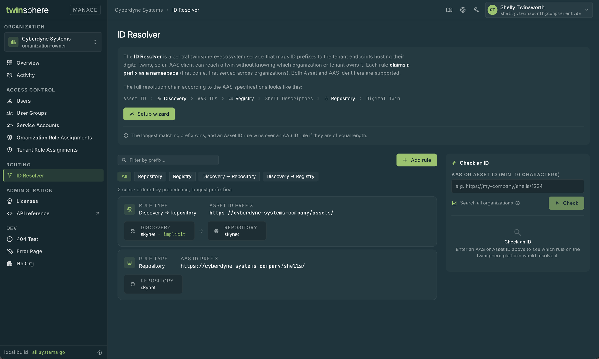

<!-- markdown-link-check-disable -->
# ID Resolver

The ID Resolver lets twinsphere applications reach a digital twin from its ID alone, without knowing which
organization or tenant hosts it. One of key use cases is public access through the twinsphere Viewer, where scanning
a QR code is enough to show a twin's public data.

You register **resolution rules** for your organization. Each rule claims an ID prefix and names the tenant
endpoints that serve the twins whose IDs start with it.

The resolver works across the whole twinsphere landscape: an ID is resolved against the rules of every
organization, not just your own. This is why a prefix belongs to exactly one organization. The first
organization to register it owns it.

The following terms are used throughout this page:

<!-- markdownlint-disable line-length -->

| Term | Meaning |
|------|---------|
| Resolution rule | Maps an ID prefix to the tenant endpoints of your organization that host the matching twins |
| Prefix | The beginning of an ID that a rule matches, for example `https://example.com/assets/` |
| Rule type | Which part of the AAS resolution chain the rule points to, see [Rule types](#rule-types) |
| AAS ID | The `id` of an asset administration shell |
| Asset ID | The `globalAssetId` or a specific asset id of the asset a shell describes |

<!-- markdownlint-enable line-length -->

## Prerequisites

- **The `organization-owner` role** in the organization. Only organization owners can view, change and check
  resolution rules. See [Roles](management-roles.md).
- **At least one tenant** in the organization.
- **Named discovery or registry instances** are *optional*: A rule can point to a named discovery or registry
  instance of a tenant. See [Discovery](cloud-documentation.md#standard-explicit-discovery) and
  [Shell Registry](cloud-documentation.md#standard-explicit-shell-registry) for how to get one.

## How resolution works

!!! tip
    If you simply want to map your asset IDs or AAS IDs to one of your tenants, you can skip this section and use the
    [setup wizard](#set-up-a-rule-with-the-wizard) in the Manage UI.

According to the AAS specifications, a client finds the data of an asset in up to three steps:

```text
Asset ID → Discovery → AAS IDs → Registry → Shell Descriptors → Repository → Digital Twin
```

Clients start from one of two kinds of ID:

- **Asset ID**, for example read from a QR code on the device. The client first asks a **discovery** for the AAS IDs
  of the asset.
- **AAS ID**, when the client already knows the shell. The client asks a **registry** for the shell descriptor, or goes
  to the **repository** directly.

The chain itself stays as the AAS specifications define it. What resolver improves is **where** a client
finds these services (discovery, registry, repository) for a given ID. The clients then simply follow the chain through
 the standard AAS APIs.

### Rule types

The type of a rule decides which services it points to, and so where the client starts.

<!-- markdownlint-disable line-length -->

| Type | For | Chain the client walks | Resolves to |
|------|-----|------------------------|-------------|
| `repository` | AAS IDs | AAS ID → Repository | Repository URL |
| `registry` | AAS IDs | AAS ID → Registry → Repository | Registry URL |
| `discovery-to-repository` | Asset IDs | Asset ID → Discovery → AAS IDs → Repository | Discovery URL and repository URL |
| `discovery-to-registry` | Asset IDs | Asset ID → Discovery → AAS IDs → Registry → Repository | Discovery URL and registry URL |

<!-- markdownlint-enable line-length -->

Use `repository` when the shells live in the tenant's own repository, which is the most common setup. Use
`registry` when you keep shell descriptors in a named registry instance, for example because the shells are
spread over several repositories. Use the `discovery-to-*` types when clients start from an asset ID.

### Prefix requirements

- **At least 10 characters.** A shorter prefix, like the bare scheme `https://`, would match nearly every ID.
- **No overlap with another organization.** Once an organization has registered a prefix, no other organization
  can register the same prefix, a longer prefix that starts with it, or a shorter prefix it starts with. The request
  is refused with `409 Conflict`. Choose prefixes under a domain or namespace you control, for example
  `https://example.com/` or `urn:example:`.

### Which rule wins

An ID matches every rule whose prefix it starts with. When several rules match, one of them wins:

1. **The longest prefix wins.** A rule for `https://example.com/assets/pumps/` beats one for
   `https://example.com/assets/`.
2. **On equal length, an asset ID rule wins.** A `discovery-to-*` rule beats a `repository` or `registry` rule with the
   same prefix.
3. **Any remaining tie** is decided by the rule's id, so the same ID always resolves the same way.

Prefixes are compared exactly, character by character, and are case-sensitive: `https://example.com/Assets/` and
`https://example.com/assets/` are different prefixes. Use the prefix exactly as your IDs are written.

!!! note
    Only the winning rule is used. If the winning rule cannot be resolved, for example because the tenant it points
    to was deleted, the ID does not resolve at all. The resolver does not fall back to the next matching rule.

## Managing rules in the Manage UI

Open [https://manage.twinsphere.io](https://manage.twinsphere.io) and select **ID Resolver** in the sidebar under
**Routing**.

[](img/twinsphere_manage_id_resolver.png)

The page lists the rules of your organization, longest prefix first, the way they take precedence. Filter them by
prefix with the search field, or by type with the chips above the list. Select a rule to edit it, or delete it with
its delete button.

Creating, changing and deleting rules is recorded under **Activity**.

### Set up a rule with the wizard

The **Setup wizard** button in the introduction at the top of the page creates a rule for the two most common
setups, in which a single tenant serves everything. It takes two steps.

**1 · Mapping.** Choose what you want to map:

<!-- markdownlint-disable line-length -->

| Choice | Use it when | Creates |
|--------|-------------|---------|
| **Map Asset IDs to a tenant** | Clients start from an asset ID, for example a QR code on the device scanned in the Viewer | A `discovery-to-repository` rule. Asset IDs are looked up in the tenant's implicit discovery, and the AAS IDs found there resolve to the same tenant's repository |
| **Map AAS IDs to a tenant** | Clients already know the AAS ID | A `repository` rule. AAS IDs resolve directly to the tenant's repository |
| **Custom** | You need a registry, a named instance, or different tenants for discovery and repository | Nothing yet. **Open rule editor** takes you to the full [rule editor](#add-a-rule-in-the-rule-editor) |

<!-- markdownlint-enable line-length -->

**2 · Prefix & tenant.** Enter the asset ID or AAS ID prefix and select the tenant. **The Result** box below the
fields shows the rule type and the resolution chain the rule will create, so that you can check it before you select
**Create rule**.

### Add a rule in the rule editor

**Add rule** above the list opens the rule editor, which supports every [rule type](#rule-types).

1. Choose the **Type**. The editor shows only the sections that this type needs.
2. Enter the prefix. The field is labelled **AAS ID prefix** or **Asset ID prefix**, depending on the kind of ID the
   type matches.
3. Select the tenant of each section. For a discovery, choose **Implicit discovery** or an **Explicit named
   instance** and enter its name. For a registry, enter the name of the registry instance.
4. Select **Create rule**.

The same editor opens when you edit an existing rule. If the prefix conflicts with another rule, the editor tells
you so and keeps your input.

### Check an ID

The **Check an ID** panel next to the rules shows which rules match an ID, and which of them wins. Enter an AAS ID
or an asset ID of at least 10 characters and select **Check**.

- With **Search all organizations** selected (the default), the check runs against the rules of every organization,
  the same way the resolver does. Rules of other organizations are marked **External org**; which organization owns
  them is not shown.
- Without it, the check uses your organization's rules only.

The first match is the **winner**: the rule the ID resolves through. Use the check before you create a rule, to
see whether the prefix is already claimed, and afterwards, to make sure your IDs resolve to the rule you expect.

## Managing rules through the Management API

All operations of the Manage UI are also available in the [Management API](management-api.md). For the full reference
of every endpoint, with all request and response fields, see the
[OpenAPI specification](https://manage.twinsphere.io/openapi/v1.json).

<!-- markdownlint-disable line-length -->

| Operation | Method | Endpoint |
|-----------|--------|----------|
| List rules | `GET` | `/api/v1/organizations/{organizationId}/resolver/rules` |
| Get a rule | `GET` | `/api/v1/organizations/{organizationId}/resolver/rules/{id}` |
| Create a rule | `POST` | `/api/v1/organizations/{organizationId}/resolver/rules` |
| Update a rule | `PUT` | `/api/v1/organizations/{organizationId}/resolver/rules/{id}` |
| Delete a rule | `DELETE` | `/api/v1/organizations/{organizationId}/resolver/rules/{id}` |
| Check an ID | `GET` | `/api/v1/organizations/{organizationId}/resolver/check?id={id}&global={global}` |

<!-- markdownlint-enable line-length -->

### Create a rule

> `POST https://manage.twinsphere.io/api/v1/organizations/{organizationId}/resolver/rules`

#### Example Request

```http
POST /api/v1/organizations/{organizationId}/resolver/rules
Authorization: Bearer {token}
Content-Type: application/json

{
  "prefix": "https://example.com/assets/",
  "type": "discovery-to-registry",
  "discovery": { "tenantId": "{tenant-id}", "implicit": true },
  "registry": { "tenantId": "{tenant-id}", "instance": "partners" }
}
```

### Check an ID

> `GET https://manage.twinsphere.io/api/v1/organizations/{organizationId}/resolver/check?id={id}&global=true`

`id` is the AAS ID or asset ID to check, as plain text. Unlike in the AAS APIs, it is not base64url-encoded; only
URL-encode it as a query value. `global` defaults to `false`, which
checks your organization's rules only. Set it to `true` to check against the rules of every organization.

#### Example Request

Checking the asset ID `https://example.com/assets/pumps/p-4711` against the rules of every organization:

<!-- markdownlint-disable line-length -->

```http
GET /api/v1/organizations/{organizationId}/resolver/check?id=https%3A%2F%2Fexample.com%2Fassets%2Fpumps%2Fp-4711&global=true
Authorization: Bearer {token}
```

<!-- markdownlint-enable line-length -->

#### Example Response (200 OK)

```json
[
  {
    "prefix": "https://example.com/assets/pumps/",
    "type": "discovery-to-repository",
    "externalOrganization": false
  },
  {
    "prefix": "https://example.com/assets/",
    "type": "discovery-to-registry",
    "externalOrganization": false
  }
]
```

The matches are ordered winner first. An empty list means that no rule matches the ID. `externalOrganization` is
`true` for a rule of another organization.
