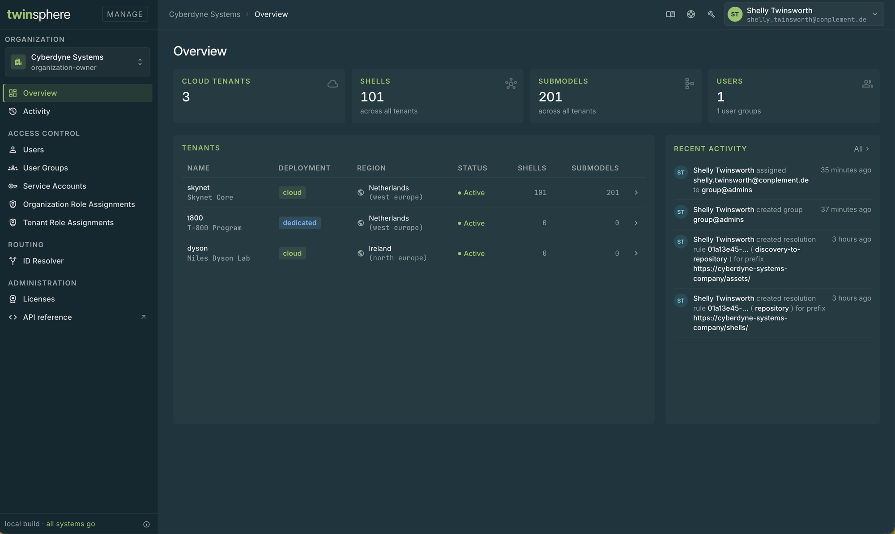
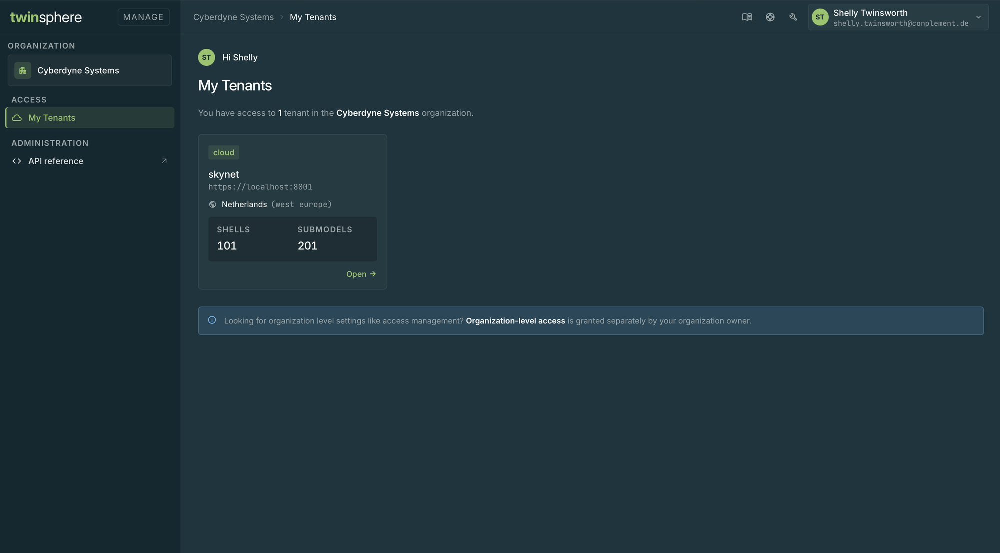
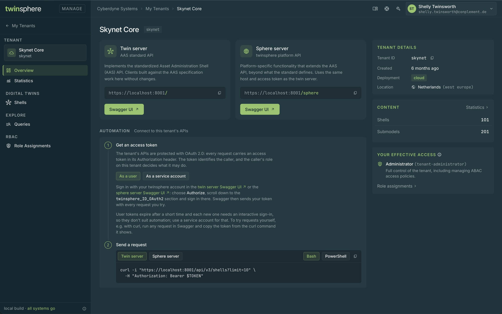
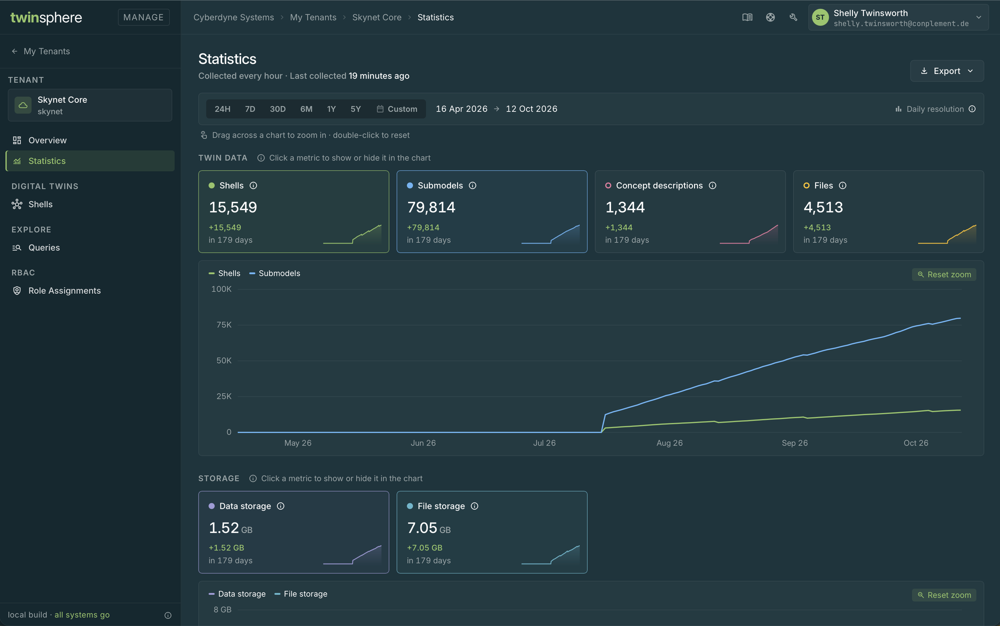
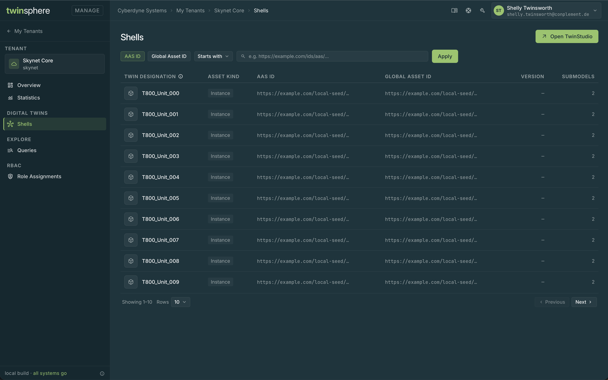
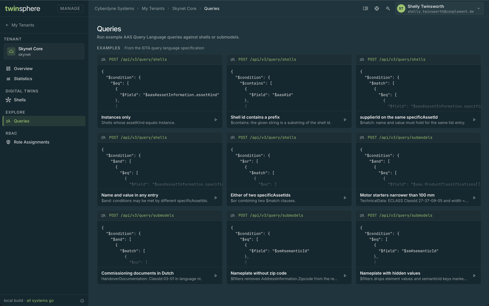
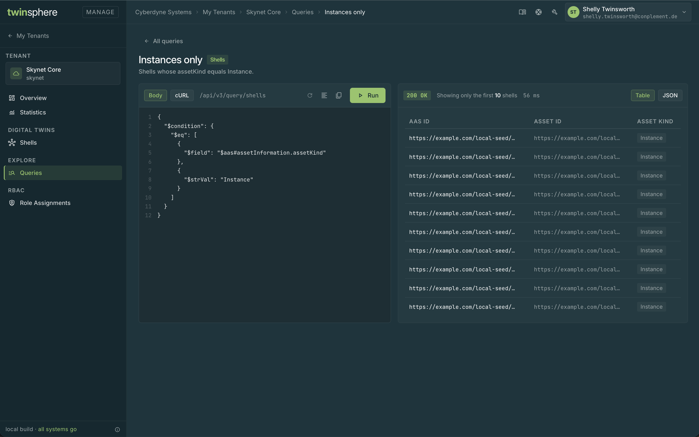

<!-- markdown-link-check-disable -->
# Manage UI

The Manage UI is the web interface for your twinsphere organization and its tenants, available at
[https://manage.twinsphere.io](https://manage.twinsphere.io). Sign in with your [twinsphere ID](id-overview.md).

What you see depends on your roles in the organization: organization owners manage the whole organization, while
users with tenant roles only see the tenants they work with. See [Roles](management-roles.md) for what each role
allows.

## Signing in

After signing in, you land on the organization you are a member of. If you are a member of several organizations,
switch between them with the organization picker at the top of the sidebar.

If you have a twinsphere ID but no organization has invited you yet, you see the **No organization assigned** page.
It shows your user ID; give it to an organization owner, who can then invite you.

## Organization view

Organization owners see the organization view, with these pages in the sidebar:

<!-- markdownlint-disable line-length -->

| Page | What you can do |
|------|-----------------|
| **Overview** | See the tenants of the organization and the latest activity, and open a tenant in the [tenant view](#tenant-view) |
| **Activity** | Follow the changes made in the organization |
| **Users** | Invite and remove users |
| **User Groups** | Manage user groups and their members |
| **Service Accounts** | Create service accounts for machine-to-machine access and manage their secrets |
| **Organization Role Assignments** | Assign and revoke the organization level roles |
| **Tenant Role Assignments** | Assign and revoke the tenant roles |
| **ID Resolver** | Manage the ID resolution rules of your organization, see [ID Resolver](management-resolver.md) |
| **Licenses** | Review and assign licenses, see [Licensing](management-licensing.md) |
| **API reference** | Open the [Management API](management-api.md) documentation |

<!-- markdownlint-enable line-length -->

## My Tenants

Users who only have tenant roles in the organization land on **My Tenants**. It lists the tenants you have access
to; select one to open it in the [tenant view](#tenant-view).

## Tenant view

The tenant view shows a single tenant. Open it from the organization **Overview** or from **My Tenants**. Which
pages you see in it depends on your roles on the tenant, see [Roles](management-roles.md).

<!-- markdownlint-disable line-length -->

| Page | What you can do |
|------|-----------------|
| **Overview** | See the tenant's details and your access to it, and learn how to connect to its APIs |
| **Statistics** | Follow the content and storage of the tenant over time, see [Statistics](cloud-statistics.md) |
| **Shells** | Browse and filter the shells of the tenant |
| **Queries** | Run AAS Query Language queries against the tenant, see [Query Language](cloud-documentation.md#query-language) |
| **Role Assignments** | Assign and revoke the tenant roles of this tenant |

<!-- markdownlint-enable line-length -->

### Statistics

### Shells

### Queries

The **Queries** page starts with the examples of the IDTA specification:

Open an example to edit and run it against the tenant:

